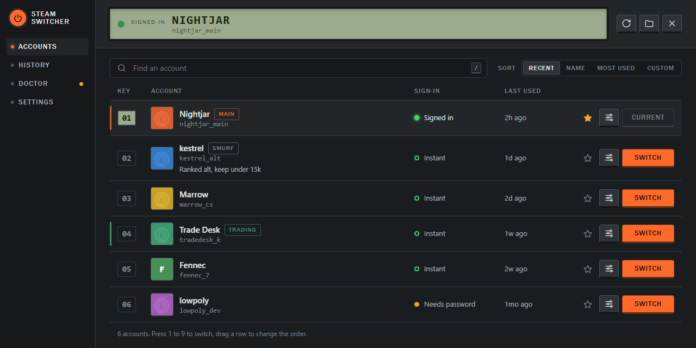
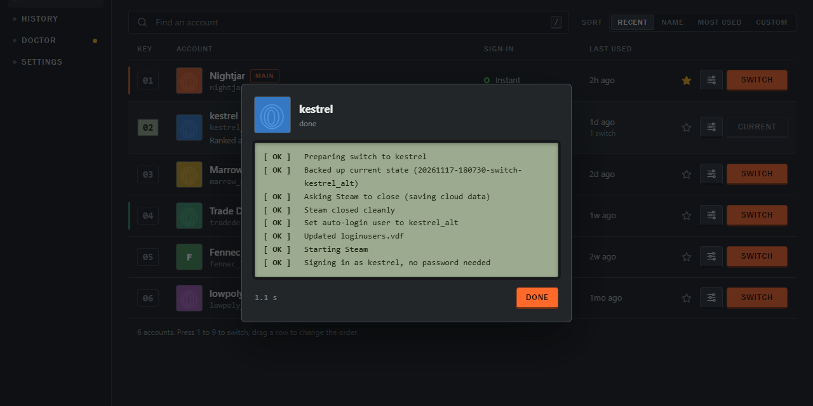

# Steam Switcher

Switch between Steam accounts on Windows without typing passwords. Pick an account, Steam closes, and it opens again signed in as that account.



## How it works

When you sign in to an account with "Remember me" ticked, Steam saves a login token for it. From then on Steam can sign that account in again with no password and no Steam Guard code. So a switch only has to:

1. close Steam with `steam.exe -shutdown`, which lets Steam Cloud finish syncing (Steam is forced closed only if it ignores this for longer than the timeout)
2. set `AutoLoginUser` in the registry and the `MostRecent` / `AutoLogin` flags in `config/loginusers.vdf` to the account
3. start Steam again

Before every switch it saves a restore point of `loginusers.vdf` and those registry values, which you can roll back from the History page. If a game is running or a download is in progress, it warns you first.

An account marked "Needs password" has no saved token yet. Switch to it once and sign in with "Remember me" ticked; after that it switches like the others.

## Running it

You need Windows 10 or 11 and Python 3.9 or newer ([python.org](https://www.python.org/downloads/), tick "Add to PATH"). It only uses the standard library, so there is nothing to install.

Double-click `Steam Switcher.bat`. The app opens in its own Edge window, or in your default browser if Edge is missing.

Steam is found through the registry. If yours is installed somewhere unusual, set the folder in Settings.

## What else it does

- Keys 1 to 9 switch to the account in that row. Ctrl+K opens a command list, / searches, R refreshes.
- Labels, colours, notes and pinning for each account, and drag to reorder.
- The games each account has played on this PC. Names come from Steam's own `appinfo.vdf` cache, so there is no API key and nothing goes online. Installed games have a button that switches and starts the game.
- SteamID64, SteamID, SteamID3 and account ID, click to copy.
- A Doctor page that spots a missing token, Offline Mode stuck on, or a damaged `loginusers.vdf`, and fixes the last two.
- Optional and off by default: Steam Guard codes from a `shared_secret` (from a Steam Desktop Authenticator `.maFile`), and a password vault for accounts that still need a manual sign-in.



## Security

- The local server listens on 127.0.0.1 only, on a random port, and every request needs a token created fresh for each run. Requests from other websites are refused, and the page runs under a strict Content Security Policy.
- Passwords never go on Steam's command line, where other programs could read them. A vault password is put on the clipboard and cleared again within a minute.
- Stored secrets are sealed with Windows DPAPI under your Windows user and tied to the account they belong to. They live in `%LOCALAPPDATA%\SteamSwitcher`, never in the app folder.

## Coming from a Steam.bat switcher

If you used a batch file with `SET acc_username[N]=` and `SET acc_password[N]=` lines, put it next to `Steam Switcher.bat`. Settings then lists its accounts and shows which ones Steam already knows. That file kept your passwords in plain text, so change them and delete it.

## Files

```
Steam Switcher.bat   launcher
app/__main__.py      starts the server and opens the window
app/server.py        local HTTP API and the page
app/steam.py         finds Steam, reads accounts and games, checks, restore points, the switch
app/vdf.py           Valve KeyValues reader and writer
app/appinfo.py       game names from Steam's binary appinfo.vdf
app/store.py         settings, labels, history, vault
app/dpapi.py         Windows DPAPI
app/guard.py         Steam Guard codes
app/winproc.py       process list and launching without a console
app/clipboard.py     clipboard with auto-clear
app/legacy.py        Steam.bat import
app/paths.py         data folder
app/window.py        app window
app/ui/              the page
```

## Removing it

Delete this folder and `%LOCALAPPDATA%\SteamSwitcher`. Steam itself is left as it is.

Not made by or affiliated with Valve. Steam is a trademark of Valve Corporation.

## License

MIT, see [LICENSE](LICENSE).

Haider Alowlaqi, aka King Specter · ceo@specters.group · haider.alowlaqi@gmail.com · Discord: 9king
